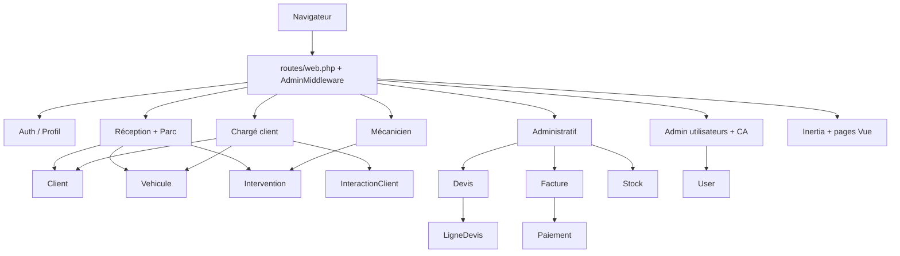
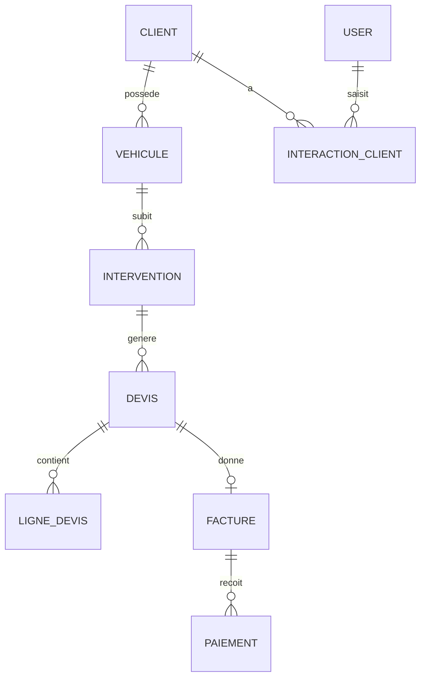

# Garage Kagnan

Application web de **gestion de garage** : réception des véhicules, suivi des interventions, devis, facturation, stock, relation client et pilotage administratif, avec prise en charge de **plusieurs sièges**.

[](https://gitdiagram.com/soibiyi/garage-kagnan?utm_source=readme&utm_medium=picture)

## Sommaire

- [Fonctionnalités](#fonctionnalités)
- [Stack technique](#stack-technique)
- [Architecture](#architecture)
- [Modèle de données](#modèle-de-données)
- [Installation](#installation)
- [Lancement avec Docker](#lancement-avec-docker)
- [Tests](#tests)
- [Workflow Git](#workflow-git)
- [Structure du projet](#structure-du-projet)

## Fonctionnalités

| Module | Description |
|---|---|
| **Authentification** | Connexion, inscription, réinitialisation du mot de passe, vérification d'e-mail, profil (Laravel Breeze). |
| **Réception** | Enregistrement du client et du véhicule, création de l'intervention, photos (y compris photos supplémentaires), gestion du parc. |
| **Mécanicien** | Vue dédiée aux interventions en cours. |
| **Chargé client** | Fiches clients et véhicules, historique des interventions, relances, suivi des interactions. |
| **Devis** | Devis directs, modification, acceptation (ligne par ligne), historique, petites fournitures et remises. |
| **Facturation** | Factures, paiements, export natif des factures. |
| **Stock** | Articles, familles et sous-familles, contrôle du stock. |
| **Administration** | Gestion des utilisateurs, tableau de bord, chiffre d'affaires par zone. |
| **Multi-sièges** | Filtre et sélecteur de siège, données rattachées à un siège (`config/sieges.php`). |

## Stack technique

- **Backend** : Laravel (PHP), Eloquent, migrations, seeders
- **Frontend** : Vue.js 3 avec Inertia.js, Tailwind CSS, Vite
- **Authentification** : Laravel Breeze
- **Base de données** : MySQL
- **Routes côté JS** : Ziggy
- **Déploiement** : Docker (PHP + Nginx), configuration de production incluse
- **Qualité** : PHPUnit, StyleCI, GitHub Actions (tests, changelog)

## Architecture



Chaque contrôleur renvoie une page Inertia : le serveur Laravel gère la logique et les données, Vue gère l'affichage, sans API séparée.

## Modèle de données



Modèles : `Client`, `Vehicule`, `Intervention`, `Devis`, `LigneDevis`, `Facture`, `Paiement`, `Stock`, `InteractionClient`, `User`.

> Ce schéma est un résumé. Les relations exactes sont définies dans `app/Models` et `database/migrations`.

## Installation

### Prérequis

- PHP 8.2 ou plus récent, avec Composer
- Node.js 18 ou plus récent, avec npm
- MySQL

### Étapes

```bash
# 1. Cloner le dépôt
git clone https://github.com/soibiyi/garage-kagnan.git
cd garage-kagnan

# 2. Installer les dépendances
composer install
npm install

# 3. Configurer l'environnement
cp .env.example .env
php artisan key:generate
```

Renseigne ensuite dans `.env` les accès à ta base MySQL (`DB_DATABASE`, `DB_USERNAME`, `DB_PASSWORD`).

```bash
# 4. Créer les tables et le compte administrateur
php artisan migrate --seed

# 5. Lier le stockage public (photos)
php artisan storage:link

# 6. Lancer l'application (deux terminaux)
php artisan serve
npm run dev
```

L'application est disponible sur `http://localhost:8000`.

Le compte administrateur est créé par `database/seeders/AdminUserSeeder.php`. **Change son mot de passe dès la première connexion.**

## Lancement avec Docker

Le dépôt contient un `Dockerfile`, un `docker-compose.yml` et la configuration Nginx (`docker/nginx/conf.d/app.conf`).

```bash
cp .env.example .env
# Adapter le .env pour la production (APP_ENV=production, APP_DEBUG=false, accès base de données)

docker compose up -d --build
docker compose exec app php artisan key:generate
docker compose exec app php artisan migrate --force --seed
```

> Adapte le nom du service (`app`) à celui défini dans ton `docker-compose.yml`.

Pour la production, pense à :
- mettre `APP_DEBUG=false`
- compiler les assets avec `npm run build`
- activer HTTPS devant Nginx
- sauvegarder régulièrement la base de données et le dossier des photos

## Tests

```bash
php artisan test
```

Les tests sont exécutés automatiquement par GitHub Actions (`.github/workflows/tests.yml`).

## Workflow Git

- `main` : branche stable, déployée
- `feature/<nom-de-la-tache>` : une branche par fonctionnalité, fusionnée par pull request

Convention de messages de commit conseillée :

```
feat: ajout du bouton Modifier sur les devis
fix: correction du nommage PSR-4 de PetiteFourniture
refactor: renommage de Vehiculeentete.vue en VehiculeEntete.vue
docs: mise à jour du README
```

Le fichier `CHANGELOG.md` est mis à jour automatiquement par GitHub Actions.

## Structure du projet

```
app/
  Http/
    Controllers/
      Admin/            Gestion des utilisateurs
      Administrative/   Dossiers, factures, stock
      Auth/             Authentification (Breeze)
      Mecanicien/       Vue mécanicien
      Reception/        Réception et parc
    Middleware/         AdminMiddleware, HandleInertiaRequests
  Models/               Client, Vehicule, Intervention, Devis, Facture, Stock...
  Support/              PetiteFourniture
config/sieges.php       Configuration des sièges
database/               Migrations et seeders
docker/nginx/           Configuration Nginx
resources/js/
  Components/           Composants Vue réutilisables
  Layouts/              Mises en page
  Pages/                Pages Inertia (Admin, Administration, ChargeClient, ...)
routes/                 web.php, auth.php
tests/                  Tests Feature et Unit
```

## Auteurs

Projet développé  **EN EQUIPE** : [@soibiyi](https://github.com/soibiyi), [@cheick](https://github.com/suuuperhackerhumann), ange836 et Ayo Mark.

## Licence

Projet privé développé pour le garage Kagnan. Tous droits réservés.